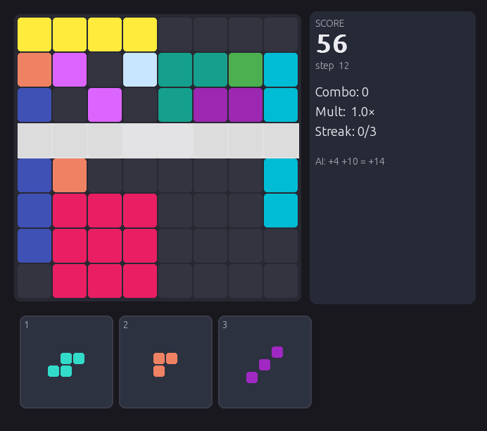

# Block Blast RL (JAX)

A from-scratch reimplementation of the Block Blast puzzle game in JAX, plus reinforcement learning agents trained on it at GPU scale.

The game logic is written so that thousands of games run in parallel on one GPU with `jax.vmap`/`jit`, which makes large-batch PPO and AlphaZero-style self-play practical on a single machine.



## What is inside

| Path | Content |
|---|---|
| `block_blast_jax/board.py`, `pieces.py`, `env.py` | Game clone: 8x8 board as bitmasks, piece set, line clears, combo and streak scoring, batched environment |
| `block_blast_jax/rl/` | PPO: actor-critic networks (MLP and CNN), action masking, training and evaluation loops |
| `block_blast_jax/alphazero/` | AlphaZero-style training: batched MCTS, self-play, replay buffer, "hard start" curriculum env |
| `block_blast_jax/ui/play.py` | Pygame UI to play the clone yourself or watch a trained agent |
| `tests/` | Scoring, bitmask correctness, MCTS, replay buffer and training smoke tests |
| `benchmarks/` | Throughput, profiling and random baseline |

Trained weights are not included; only the model architectures and training code.

## Models

- **ActorCritic (MLP):** two 128-unit dense layers, masked policy head over 192 actions (3 tray slots x 64 cells), value head, optional bf16 compute.
- **CNNActorCritic:** 3x3 conv stack over the board, concatenated with tray one-hot and combo/streak features, then the same policy/value heads.
- Invalid moves are masked out before sampling, so the agent never wastes actions.

## Results

Measured on a laptop RTX 4050 (6 GB). Episode length = number of pieces placed before game over.

**Simulation throughput** (`benchmarks/bench_throughput.py`, random actions, 200-step `lax.scan`):

| Parallel games | Env steps / s |
|---|---|
| 1 | 21K |
| 256 | 2.2M |
| 4096 | 3.4M |
| 16384 | 3.5M |

**Agents:**

| Agent | Eval games | Mean episode length | Mean score |
|---|---|---|---|
| Random legal moves | 1000 | 11.6 | 50 |
| PPO, MLP 128x2, ~750M frames (~9 min) | 1024 | 28.4 | 250 |
| AlphaZero-style MCTS (200 sims), hard-start curriculum | 3 seeds | 124 | 2031 |

The PPO hidden-size ablation (64 / 128 / 256 units, 50M frames each) found 128 units best; larger networks were slower and did not survive longer.

AlphaZero runs with MCTS at evaluation time reach much longer games, but single-seed evaluations varied a lot, so the table reports the 3-seed number.

## Setup

```bash
python -m venv .venv && source .venv/bin/activate
pip install -r requirements.txt
pytest -q
```

For GPU training install the CUDA build of JAX (`pip install -U "jax[cuda12]"`).

## Usage

```bash
python -m block_blast_jax.ui.play
python -m block_blast_jax.rl.train
python -m block_blast_jax.alphazero.train_az --total_iters 400 --num_simulations 200
python benchmarks/bench_throughput.py
```

## Notes

- The main metric is episode length (how long the agent survives), not raw reward, since reward shaping makes reward alone misleading.
- Rule details (piece set, combo and streak scoring) were matched to the original game by playing and observing it; this repository contains no code or assets from the original app.
